# Support SLA & Capacity Review

Operations analytics for a software company's support desk. It answers three questions: why SLA attainment fell, how many agents each hour of the week needs, and whether to ask for more headcount. It covers 2,330 real tickets from 2023 plus a 20× planning scenario, built with SQL (DuckDB), Python (Erlang C, simulation, integer programming) and a Streamlit app.

> **Bottom line:** the SLA that fell is **resolution**, not response: on-time resolution went **73.6% → 60.6% from Q1 to Q4 2023** [real data]. That is a process change plus a stale backlog, **not a capacity shortfall**. Recommendation: **no headcount request this quarter**. Fix stale tickets and the resolution slow path first.

**Today's roster vs proposed roster** [synthetic planning scenario: 20× the export's volume, same 23-FTE desk, today's roster assumed]

| Roster | Shifts per weekday | Shifts per weekend day | Simulated response SLA (optimistic / conservative rule) |
|---|---|---|---|
| Today (assumed: headcount set by new-ticket counts) | 18–21 | 9 | **85.8%** / 82.6% |
| **Proposed: workload-matched (more weekend cover)** | 18 | 12–13 | **87.6%** / 84.7% |
| Hire instead: today's roster + 7 weekend shifts (1.4 FTE, €94k in year 1) | 18–21 | 12–13 | 87.6% / 85.5% |

**SLA from 85.8% to 87.6% with no extra headcount.** Over 5 independent simulated years the gain is +1.5 to +2.0 points (+1.3 to +1.9 under the conservative rule). The gain holds only if (a) today's roster really is weekday-weighted and (b) weekend follow-up work is done when it arises. No roster can beat the **87.8% ceiling** set by slow and missed pickups. The SLA that actually fell (resolution) is not moved by any roster.

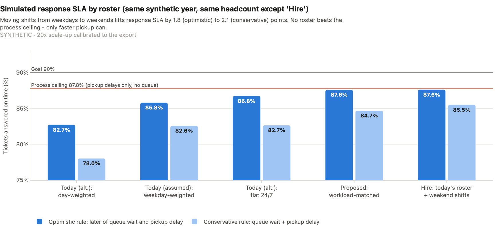

---

## The question

The Support Director asked: *"SLA attainment is falling and the team says we don't have enough people. I need to request headcount next quarter. Did volume go up or did efficiency drop? How many people do we need per time slot? Can we fix it without adding people?"* The full request and the seven analysis questions it became are in [docs/01_request_and_scope.md](docs/01_request_and_scope.md).

## Three findings

1. **[REAL] Resolution SLA fell; volume did not grow.**
   - Resolution SLA: 73.6% in Q1 → 60.6% in Q4 (Q4 95% CI 56.6–64.5%).
   - Response SLA held at 87.2% and improved in H2 (85.4% → 89.1%).
   - Volume was flat: H2 was −2.7% vs H1, and the channel and topic mix did not move.
   - A shift-share decomposition puts **−0.3** of the −12.9-point Q1→Q4 change on channel mix and **−12.7** on slower handling within channels.
2. **[REAL] What changed is a new slow path plus a stale backlog. It is not a capacity shortfall.**
   - Tickets resolved late went from **9.8% to 21.8%** of all tickets, rising gradually from March to October.
   - The median resolution time barely moved (20 → 23 h), but the 90th percentile doubled (46 → 104 h).
   - The rise appears in every channel, priority, topic, tier and agent. None of 1,268 segment combinations stands out after a false-discovery-rate check.
   - Breach rates do not rise with workload (trend tests p = 0.28–0.90), and the active backlog stayed flat at about 15 tickets.
   - Separately, **418 tickets (17.9%) were never resolved**. They are **53% of all resolution breaches**, with a median age of 202 days.
   - Response breaches are pickups missed, not queues: email breaches are a median 3.5 hours late.
3. **[SYNTHETIC] Capacity, planned at 20× volume.**
   - A desk this size needs about **23 FTE**. That is 19 FTE in pure workload maths, or 16–28 FTE if handle times are 30% lower or higher. Total workload sets the number, not the 2-minute chat/phone target.
   - The export has no intraday peak, so the right roster is near-flat. The lever is the weekday/weekend balance, which is worth about 2 points of response SLA.
   - Hiring 1.4 FTE of weekend shifts gets the same result for €94k in year one.
   - Self-service and routing could take ~20% of tickets (an assumption) and free about 4 FTE of capacity, where the range is 3–7.

## Recommendations

| # | Action | Owner | Expected impact | Measure |
|---|---|---|---|---|
| 1 | Sweep the 418 stale tickets, then set a standing policy for anything open more than 7 days | Team leads | Removes up to 53% of resolution breaches, a reporting or a customer fix depending on what the sweep finds | Never-resolved share < 5% of each month's tickets |
| 2 | Find and reverse the resolution slow path that appeared in spring 2023 | Director + tier-2 lead | Back to the H1 late rate would put on-time resolution near 74% (a target, not a forecast) | Time-in-status from the ticket audit log; late share ≤ 10% |
| 3 | No headcount request this quarter; revisit at a trigger | Director | Avoids ~€94k in year one in the planning scenario | Volume > +25% vs 2023, or < 90% of contacts reaching an agent in time |
| 4 | Re-roster toward workload (more weekend cover), after checking today's real roster | WFM + team leads | +1.5 to +2.0 pts response SLA [synthetic, conditional] | Response SLA and queue wait by hour of week |
| 5 | Pilot a 45-minute "unanswered email" alert and push routing for chat/phone | Team leads + tooling | +2.2 pts if the alert catches half of email breaches (an illustration, until the catch rate is measured) | Emails answered within 60 min |
| 6 | Pilot self-service for pricing/licensing and invoicing; route feature requests to a feedback portal | Knowledge owner | ~86 agent-hours a week, ~4 FTE of capacity (assumed deflection) | Tickets per topic vs baseline |

Owners, risks and dates are in [docs/headcount_business_case.md](docs/headcount_business_case.md) and [reports/action_plan.md](reports/action_plan.md). The one-page memo for the Director is [docs/readout.md](docs/readout.md).

## Key charts

| | |
|---|---|
| 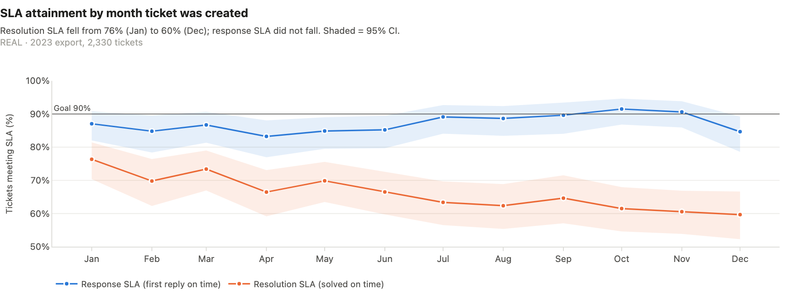 | 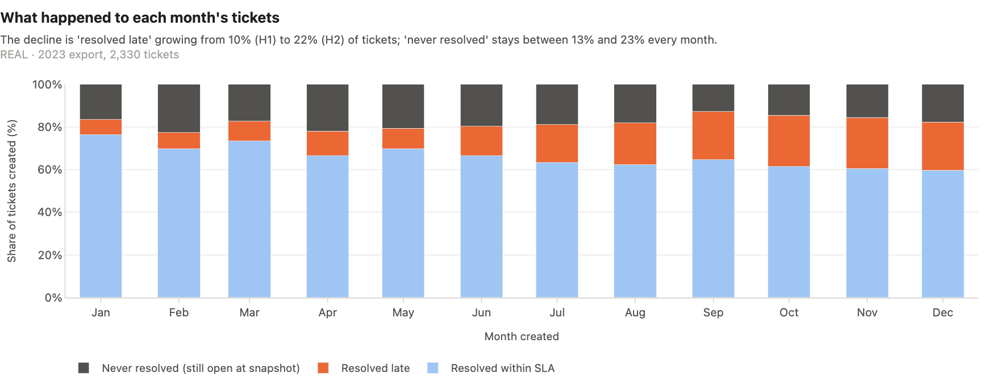 |
| 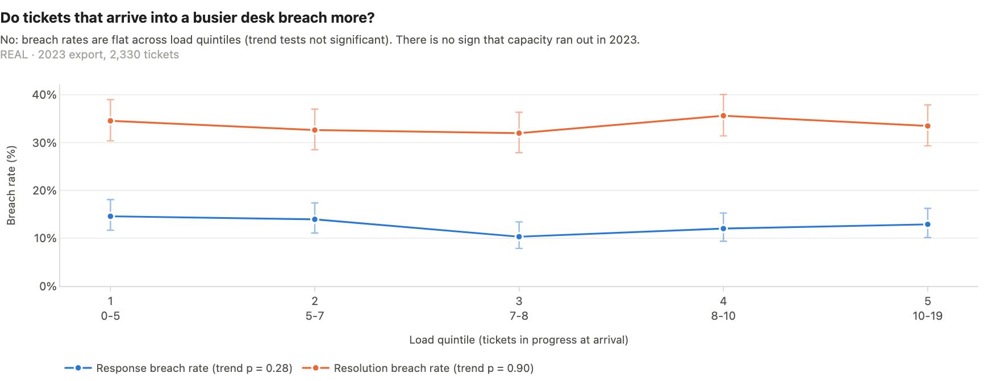 | 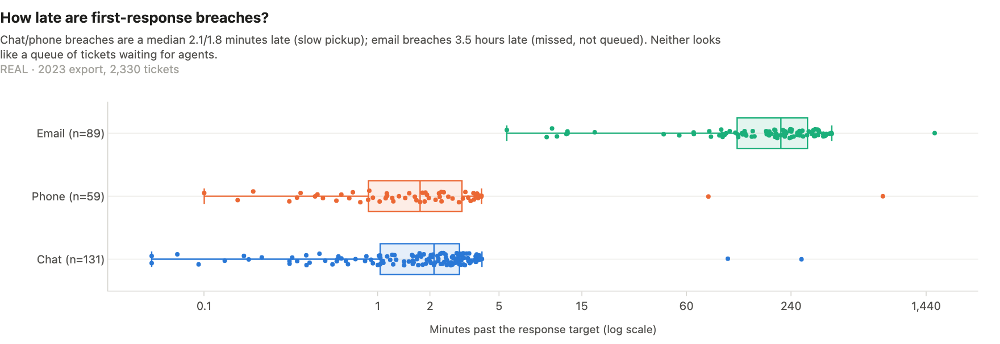 |
| 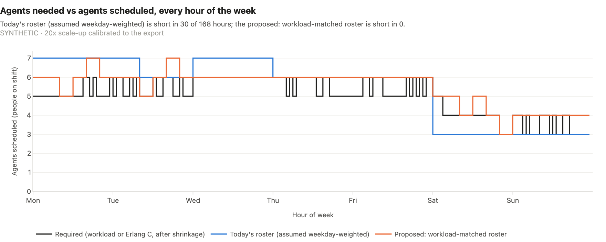 | 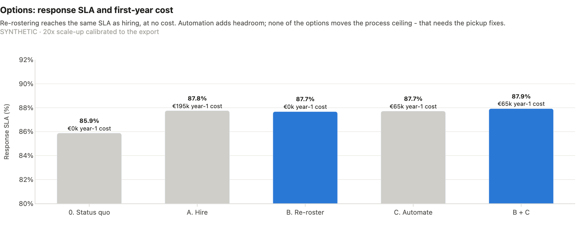 |

## Demo app (Streamlit)

```bash
streamlit run dashboard/app.py
```

The 8 pages follow the story: Overview → Data & Sanity Checks → Volume Patterns → Efficiency & SLA → Backlog Diagnosis → Staffing Model → Automation Opportunities → Headcount Business Case. Each page states the question it answers and ends with a plain-language "How to read this" box. These pages recompute live as you move their controls:

- **Staffing:** the SLA goal, handle time, shrinkage, occupancy and volume sliders re-run Erlang C and the roster optimiser.
- **Automation:** the per-topic deflection sliders recompute hours saved and FTE.
- **Business case:** the cost sliders reprice every option.
- **Backlog:** the threshold for "aged" tickets re-runs the SQL.

| | |
|---|---|
| 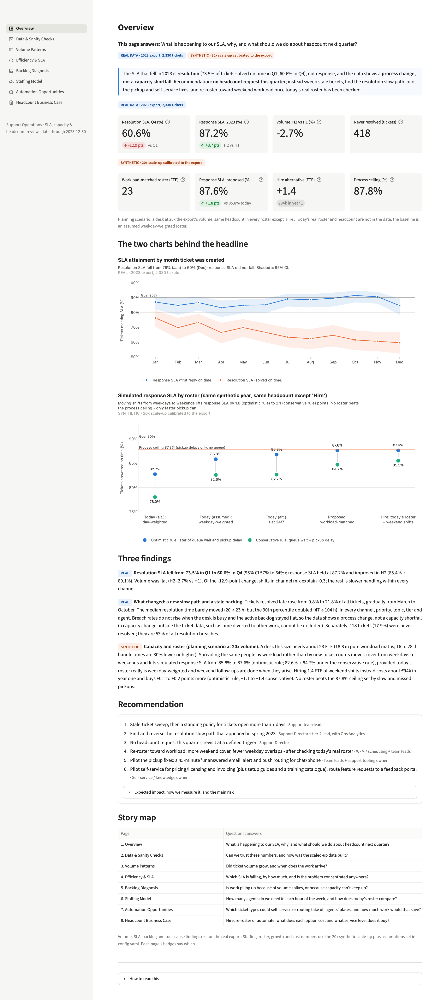 | 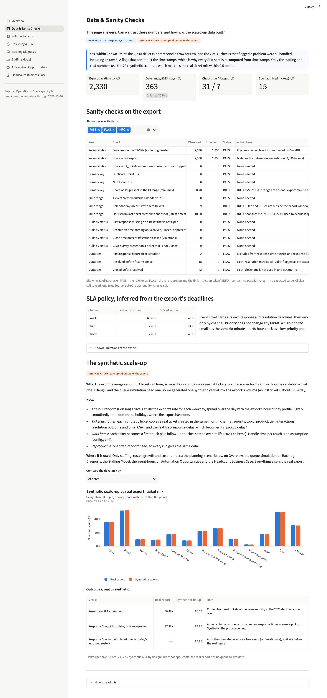 |
| 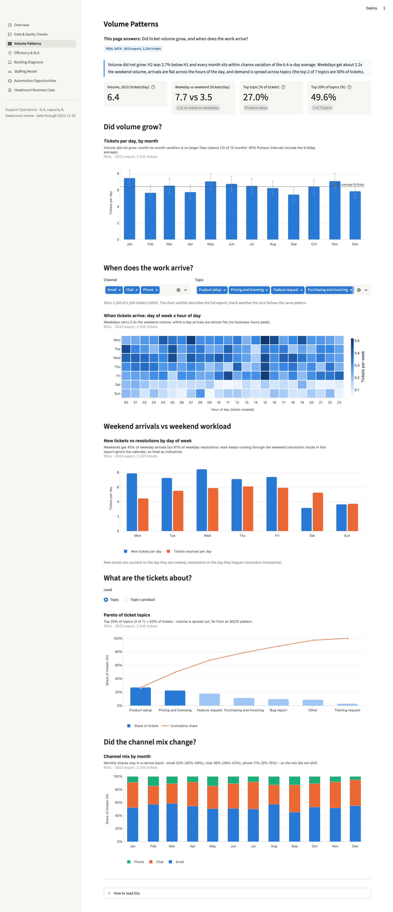 | 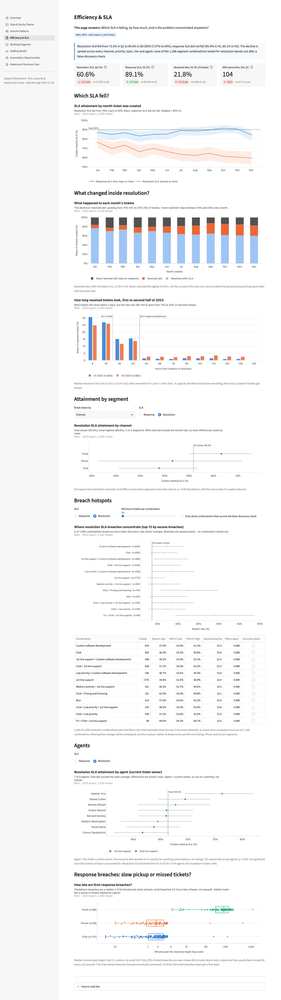 |
| 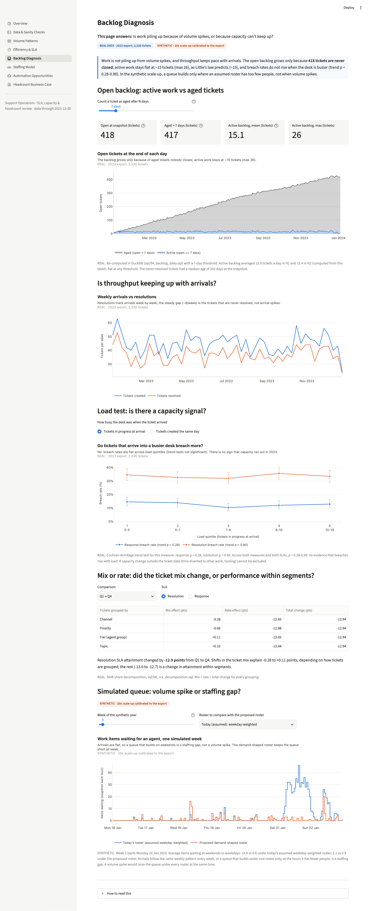 | 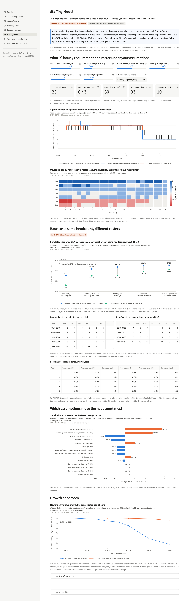 |
| 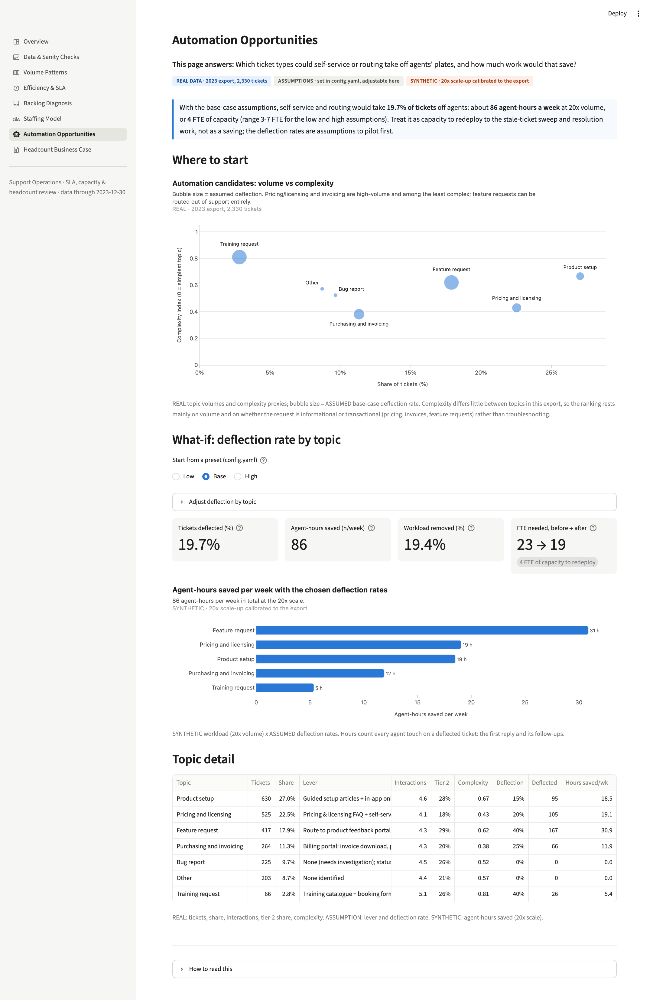 | 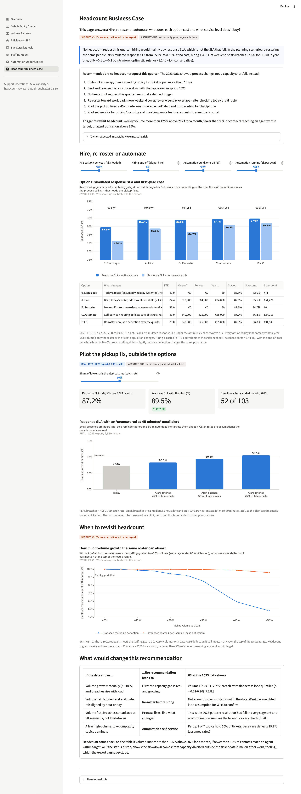 |

The full analysis as one file, viewable without running anything: **[reports/report.html](reports/report.html)** (self-contained; download and double-click). The notebook exports are in `reports/0*.html`.

## Method and data

| | Real export | Synthetic scale-up |
|---|---|---|
| What | 2,330 tickets, 2023-01-02 to 2023-12-30 ([Kaggle `suvroo/technical-support-dataset`](https://www.kaggle.com/datasets/suvroo/technical-support-dataset), MIT) | 46,598 tickets: one year at 20× volume, generated in `src/support_ops/synth.py` |
| Used for | Volume, SLA KPIs, breakdowns, hotspots, root cause, backlog, topic mix | Hourly staffing, roster comparison, simulation, growth, FTE and cost |
| How it is built | Cleaned in SQL; every SLA recomputed from timestamps (the raw flags are wrong on 15 tickets) | Arrival rate by weekday and hour from the export; real tickets bootstrapped by month (mix, interactions, resolution outcome, real pickup delay). Channel, topic and priority shares match within 0.5 points |

- **Metrics** are defined before use in [docs/02_metric_definitions.md](docs/02_metric_definitions.md) and computed in DuckDB SQL ([sql/](sql/), each file runs standalone).
- **Sanity checks:** 31 checks, 7 flagged and all handled, in [docs/03_data_quality_checks.md](docs/03_data_quality_checks.md).
- **Root cause:**
  - a shift-share (mix vs rate) decomposition;
  - breach hotspots over 1,268 combinations with Wilson intervals and a Benjamini-Hochberg false-discovery check;
  - breach rate vs workload at arrival (Cochran-Armitage trend tests);
  - a backlog flow analysis with a Little's law check;
  - breach lateness by channel.

  Details: [docs/root_cause_analysis.md](docs/root_cause_analysis.md).
- **Staffing model:** requirement per hour of the week = max(Erlang C agents for 90% of chat/phone answered within 2 min, workload / 85% max occupancy, 1). It is grossed up for 30% shrinkage and rounded once to whole people.
  - An integer programme (`scipy.optimize.milp`) turns the requirement into 8-hour shifts.
  - A discrete-event simulation replays the synthetic year ticket by ticket under each roster. Chat and phone may interrupt email work, and the simulation reproduces Erlang C within a point on textbook cases.
  - Today's roster is not in the data, so three versions are compared at the same headcount.
  - Response time is bracketed by an optimistic rule (the later of queue wait and pickup delay) and a conservative rule (their sum).

  Details: [docs/capacity_plan.md](docs/capacity_plan.md) and [notebooks/04_staffing_model.ipynb](notebooks/04_staffing_model.ipynb).
- **Assumptions** with their source and sensitivity are logged in [docs/assumptions.md](docs/assumptions.md): handle times, shrinkage, occupancy, SLA goal, scale, the meaning of "interactions", follow-up timing, costs and deflection rates. Every number in this README is in `reports/key_numbers.json`, which `python run.py` writes.

## Limitations

- **Provenance.** The export is a public data-challenge dataset, and some patterns look generated: a flat 24-hour arrival curve for European customers, CSAT unrelated to breaches, resolution clocks that ignore weekends, and on-time response times spread evenly inside the target window. Relationships between fields are therefore not over-read.
- **Synthetic numbers are conditional.** They depend on the 20× scale, assumed handle times, an assumed current roster and how follow-ups are timed. If weekend follow-ups wait until Monday, the re-roster gain is no longer robust (−2.1 to +2.3 points). The model is a template to re-run on the real roster and handle-time data.
- **Causes are not in the data.** We can date the resolution slowdown but not explain it. Explaining it needs ticket status history.
- **Agent attribution.** "Agent Name" is the current ticket owner, so agent comparisons are for coaching, not ratings.

## How to run

```bash
uv venv --python 3.12 .venv && source .venv/bin/activate
uv pip install -r requirements.txt
make all            # = python run.py + executed notebooks; ~2 minutes
```

`make all` reads the raw CSV, cleans it, runs the data-quality checks and the SQL KPIs, and runs the root-cause tests. It then builds the synthetic year and the staffing model, runs the simulations, automation sizing and business case, and writes `data/processed/*.parquet`, `reports/key_numbers.json`, `reports/report.html`, `reports/figures/*.png`, the executed notebooks and their HTML exports. The random seed is fixed (42), so two runs give identical numbers.

- **Data location:** set `data.raw_csv` in `config.yaml`, or copy `.env.example` to `.env` and set `SUPPORT_TICKETS_CSV=/path/to/Technical Support Dataset.csv`. The default is `~/projects/data-projects/datasets/p6-support-tickets/technical-support/`. Raw data is never committed (`data/`, `*.csv` and `*.parquet` are gitignored).
- **Other targets:** `make test` (Erlang C, simulation, roster, what-if tests), `make app` (Streamlit), `make screenshots` (needs `requirements-dev.txt` and `playwright install chromium`).

## Repository map

```
config.yaml              all parameters and assumptions
run.py / Makefile        one-command pipeline
sql/                     cleaning, data-quality checks, KPI queries (DuckDB, standalone)
src/support_ops/         synth, erlang, simulation, roster, staffing, rca, automation, business_case, charts, report
dashboard/               Streamlit app (app.py + 8 pages)
notebooks/               01 volume · 02 efficiency · 03 backlog · 04 staffing · 05 automation
reports/                 report.html, notebook HTML exports, figures, key_numbers.json, action_plan.md
docs/                    plan, scope, metric definitions, data quality, synthetic data, assumptions,
                         root cause, capacity plan, business case, readout
tests/                   pytest
```
